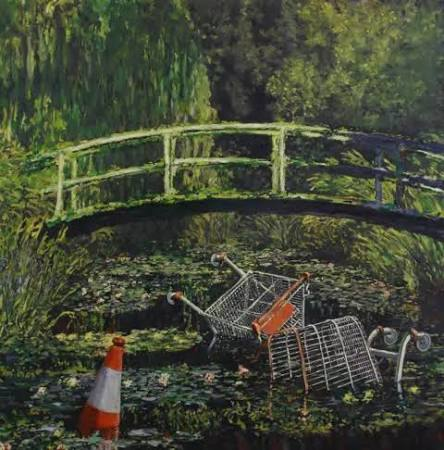

# Trolley Chaos

## Game idea

The idea came from one time i was just pushing a cart around in ALDI and i though it would make a cool game a trolley/cart based game cus of the physics required (i though drift and stuff) so thats how it came to my mind

## Enemies

* You have to avoid obstacles (in a parking lot), and maybe some cars that are going around (future idea). 
The enemies i have implemented so far:

- dog: chases u around and u die if it hits u 

Enemies i want to implement

- crazy kids: if u get close enough they will try to get u
- cars: when crossing roads there is cars and if u get run over game over (see that, it rymes)
- police: if u hit a house or a shop they come for you (like gta?)
- bear: this is like the final boss, i want it to be like hiding andu can only get to the bear if u are going for something special so ye and its like hiding in a park

## Places

I have implemented 
- the shop: initial place, really basic

I want to implement
- city place: just like a city, and there is buildings, idk 
- park: a park to have the crazy kids or smth, and it could work as a transition place for the river
- the river: so it owuld work as one of the 4 boundaries (cus i dont wanna have my game endless or just plain after u get out of the main part) and if u fall into the river it would have like the "Show me the monet" from bansky
> 
- the forest: the park also serves as a transition for the forest where the bear will be hiding 
- the neighbourhood: this is the final place u will have to get here after escaping everything to then finally finish ur mission and return with what u shopped

## Objects

implemented 
- none

want to implement
- groceries: u pick em up and thats how ur score is decided at the end (btw the idea is that there is one that boosts up a lot behind the bear)
- starenght stuff: like power ups (idk what im doing now its getting too crazy)

## Gameplay

iplemented:
- boosts with one key (space)
- directs with ur mouse point

want to implement:
- maybe a way to drift sideways?
- what if the guy takes his feet off the ground and it gives him a boost (this one could be nice)

if u wanna play here is the link:

https://benvelzul.itch.io/trolley-chaos